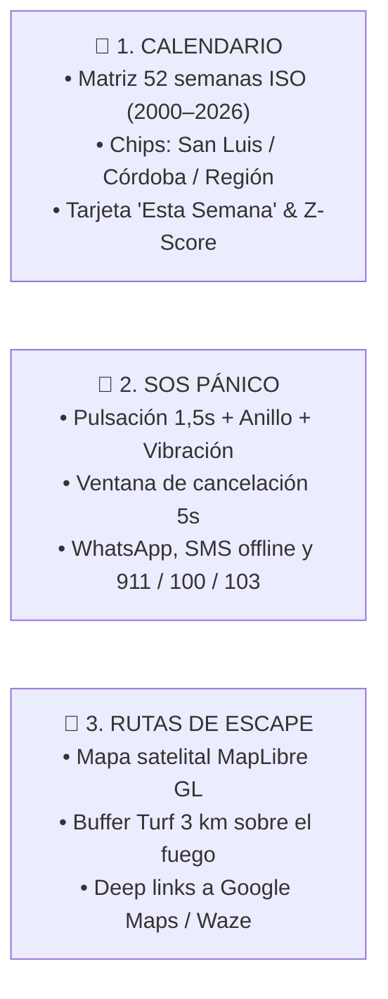

# 🔥 SeMF Mobile — Alerta, Calendario & Rutas de Evacuación ante Incendios

[](mobile/)
[](docker-compose.yml)
[](mobile/tests/)
[-red.svg?style=for-the-badge)](https://firms.modaps.eosdis.nasa.gov/)
[](LICENSE)

**SeMF Mobile** es una aplicación web progresiva (PWA) de respuesta y auxilio ciudadano ante incendios forestales en las provincias de **San Luis** y **Córdoba, Argentina** (con foco primario en San Luis). Diseñada bajo principios *mobile-first* (optimizada desde 360×640 px hasta tablets), opera de forma 100% autónoma, sin bases de datos externas pesadas y con capacidades completas fuera de línea (*offline-first*).

---

## 📱 Las 3 Pantallas Esenciales



### 1. Calendario Climatológico de Incendios (2000–2026)
- **Filtro Rápido por Zona:** Selector de chips táctiles: *San Luis (capital y alrededores)* [por defecto], *Sierras de Córdoba*, y *Toda la región*.
- **Tarjeta "Esta Semana":** Semáforo comprensible (Bajo / Medio / Alto / Extremo) que compara la semana actual contra el promedio histórico climatológico.
- **Heatmap de 52 Semanas ISO x 27 Años:** Matriz interactiva de scroll horizontal fluido. Al tocar cualquier celda se despliega un *bottom sheet* táctil con el conteo de focos armonizados, potencia térmica radiativa (FRP en MW) y anomalía Z-Score respecto a la media histórica $\mu \pm 1\sigma$.
- **Rendimiento Ultraliviano:** Datos divididos en archivos JSON de `< 100 KB` por zona, cargados bajo demanda y cacheados por el Service Worker.

### 2. Rutas de Evacuación Segura con Evitación de Fuego
- **Monitoreo Satelital en Tiempo Real:** Detecciones activas NASA FIRMS (VIIRS 375 m / MODIS 1 km) y catálogo auditado de refugios, cuarteles de bomberos y centros de defensa civil.
- **Botón Primario "SALIR AHORA":** Detecta la posición GPS del usuario, evalúa los 2 refugios seguros más cercanos y traza el camino evitando el fuego.
- **Algoritmo de Evitación de Fuego (Buffer 3 km):** Aplica un perímetro de seguridad de 3 km mediante Turf.js sobre los focos activos de las últimas 12 horas, enviando los polígonos a evitar a OpenRouteService / Valhalla (`avoid_polygons`).
- **Respaldo de Emergencia Offline:** Si no hay conexión o no hay API key de ruteo configurada, utiliza rutas estáticas de contingencia precalculadas por localidad.
- **Guía Conservadora Sin Salida:** Si el fuego rodea el área, orienta la evacuación de forma perpendicular al vector del viento hacia zonas quemadas o sin vegetación, destacando el botón de pánico.
- **Navegación Externa:** Botones directos con destino cargado hacia **Google Maps**, **Waze** y **Apple Maps**.

### 3. Botón de Pánico SOS (Protocolo de Vida)
- **Activación Segura por Presión Sostenida:** Botón circular prominente activable tras mantener presionado 1,5 segundos (con anillo animado de progreso y vibración háptica), cancelable durante 5 segundos con aviso visual y sonoro.
- **Composición Automática del Mensaje de Rescate:**
  > `"EMERGENCIA INCENDIO. Mi ubicación: https://maps.google.com/?q={lat},{lon} (±{acc}m). Foco activo más cercano: {dist}km al {rumbo}. Destino: {refugio}."`
- **Despacho Multicanal en 1 Toque:**
  - **WhatsApp:** Abre chat con mensaje precargado para contactos de confianza.
  - **SMS Nativo:** Funciona **100% sin conexión de datos móviles** ni cobertura de internet.
  - **Compartir Nativo:** Web Share API para enviar por cualquier canal instalado.
  - **Llamadas Directas:** 911 (Emergencias), 100 (Bomberos), 103 (Defensa Civil / San Luis Solidario) y números de manejo del fuego provinciales.
- **Contactos de Confianza:** Almacenamiento local seguro (`localStorage`) de hasta 3 contactos.
- **Pantalla Activa:** Mantiene la pantalla encendida automáticamente mediante **Wake Lock API**.

---

## 🚀 Despliegue Rápido con Docker (1 Solo Comando)

No requiere bases de datos, claves de API ni pasos previos. Todo viene preconfigurado:

```bash
docker compose up --build
```

Abre en tu navegador:
👉 **[http://localhost:8090](http://localhost:8090)**

Para comprobar la salud del servicio:
```bash
curl http://localhost:8090/api/health
```

---

## 💻 Ejecución Local para Desarrollo

Requisitos: Node.js 20+ LTS y npm.

```bash
# 1. Ingresar a la carpeta mobile
cd mobile

# 2. Instalar dependencias
npm install

# 3. Iniciar servidor de desarrollo con recarga rápida (HMR)
npm run dev

# 4. Compilar para producción (Cliente Vite + Servidor Node)
npm run build

# 5. Iniciar servidor de producción local
npm start
```

---

## ☁️ Deploy en Vercel (Paso a Paso)

La aplicación está completamente adaptada para ejecutarse en la infraestructura Serverless y CDN de Vercel sin tocar ni modificar ningún proyecto previo:

1. **Importar Repositorio:** En el panel de [Vercel](https://vercel.com), selecciona **Add New Project** e importa `SeMF-SpaceAppsNASA`.
2. **Configurar Root Directory:** En la configuración del proyecto, haz clic en **Edit** junto a *Root Directory* y selecciona:
   ```text
   mobile
   ```
3. **Framework Preset:** Selecciona `Vite` (detectado automáticamente).
4. **Variables de Entorno (Opcionales):**
   - `FIRMS_MAP_KEY`: Tu clave de NASA FIRMS (si deseas consultar datos satelitales en vivo; si se omite, opera con los datos locales incluidos).
   - `ROUTING_PROVIDER`: `openrouteservice` o `static_fallback`.
   - `ORS_API_KEY`: Tu clave de OpenRouteService (opcional).
5. **Hacer Clic en Deploy:** Vercel compilará la SPA estática en `/dist` y desplegará las Serverless Functions de `/api/*.ts` de forma automática con caché inmutable y revalidación en segundo plano.

---

## 🧪 Suite de Pruebas Automatizadas

La aplicación cuenta con pruebas exhaustivas unitarias, de integración y de humo en viewport móvil real (390×844 px):

```bash
cd mobile

# Ejecutar tests unitarios, esquemas de datos y handlers
npm test

# Ejecutar test de humo E2E con Playwright simulando iPhone / Android
npm run test:e2e
```

---

## ⚠️ Limitaciones Críticas y Responsabilidad

1. **Latencia Satelital (NASA FIRMS):** Los satélites polares MODIS (Terra/Aqua) y VIIRS (Suomi-NPP / NOAA-20 / NOAA-21) realizan sobrevuelos programados (2 a 4 pasadas diarias por hemisferio). Una ausencia de detección satelital en el mapa **no garantiza** la ausencia de fuego activo en el terreno en ese instante.
2. **Naturaleza del Fuego:** El comportamiento de los incendios de interfaz serrana es altamente dinámico y depende de ráfagas de viento y pendiente topográfica. Las rutas sugeridas buscan minimizar el riesgo geográfico pero deben ser contrastadas con la visibilidad en el camino.
3. **Prioridad del 911:** Esta aplicación complementa y agiliza la comunicación pero **NO reemplaza** llamar inmediatamente a las autoridades oficiales a través del **911** o el **100**.

---

## 📜 Origen de Datos y Reconocimientos

- **Proyecto Base y Lógica Científica:** Este desarrollo reutiliza datos históricos preagregados, lógica de normalización y definiciones geográficas elaboradas en el proyecto de referencia **[HackatonNASA](https://github.com/Fjoel00/HackatonNASA)** por el equipo *Maxwell Crew*. Consulta la trazabilidad completa en [docs/ORIGEN_DE_DATOS.md](docs/ORIGEN_DE_DATOS.md).
- **Datos Satelitales:** Agradecemos al programa NASA LANCE FIRMS operado por el NASA Goddard Space Flight Center / ESDIS.
- **Cartografía de Refugios:** Catálogo oficial auditado de cuarteles de Bomberos Voluntarios y Policía de San Luis y Córdoba.

---

## 📄 Licencia

Este proyecto está bajo la Licencia **MIT**. Consulta el archivo [LICENSE](LICENSE) para más detalles.
