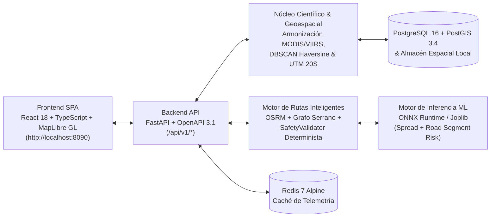

# 🔥 SeMF 2.0 — Plataforma Geoespacial de Monitoreo Satelital Multi-Sensor, Machine Learning y Evacuación Inteligente

**Reingeniería Arquitectónica Independiente y Modular**  
*Región de Estudio Principal: Sierras de Córdoba y San Luis, Argentina (`BBOX: -66.0, -33.5, -63.5, -31.0`)*

---

## 📌 1. Visión del Producto

**SeMF 2.0** es una plataforma profesional de monitoreo satelital, análisis histórico climatológico, inteligencia predictiva y asistencia táctica para la gestión de incendios forestales y evacuación civil.

Integra en una arquitectura modular desacoplada:
- **Fusión y Armonización Física Satelital (NASA FIRMS):** Unificación de observaciones **MODIS** (Terra/Aqua a $1000\text{ m}$) y **VIIRS** (Suomi-NPP / NOAA-20 / NOAA-21 a $375\text{ m}$), normalizando canales térmicos MIR ($\sim 4\,\mu\text{m}$) y TIR ($\sim 11\,\mu\text{m}$), diferencial térmico $\Delta T = T_4 - T_5$, saturación física de banda $I_4$ ($\ge 366.5\text{ K}$), huella proyectada ($\text{scan} \times \text{track}$), densidad radiativa ($\text{MW/km}^2$) e integración trapezoidal de Energía Radiativa (`FRE` en $\text{MJ}/\text{GJ}$).
- **Motor Geoespacial Métrico (`EPSG:32720`):** Clustering geodésico **DBSCAN Haversine** ($\varepsilon = 2.5\text{ km}$), reconstrucción de envolventes y buffers de exclusión en proyección métrica **UTM Zona 20S (`EPSG:32720`)** e isócronas predictivas de avance a **1h, 3h y 6h** combinadas con telemetría meteorológica de **Open-Meteo** y regla `30-30-30`.
- **Motor de Rutas de Escape Inteligentes (Determinista + ML):** Evaluación multi-alternativa sobre red vial (OSRM + Grafo Vial Serrano de Córdoba y San Luis), validación topológica innegociable de intersecciones con perímetros activos, conos de propagación y buffers de seguridad configurables, expansión por antigüedad de datos (`STALE_FIRE_DATA`), puntuación de riesgo por segmento mediante Machine Learning y corredor conservador de flanco cuando todas las carreteras se encuentran bloqueadas.
- **Machine Learning Reproducible y Multi-Modelo (`ml/`):** Pipeline independiente de entrenamiento, comparación y serialización en dual format (`.onnx` nativo con `skl2onnx` y `.joblib`) junto con Model Cards detalladas para **4 modelos supervisados**:
  1. `FireSpreadPredictor` (`GradientBoostingRegressor`: $R^2 = 0.9794$, $\text{MAE} = 0.0825\text{ km/h}$).
  2. `RoadSegmentRiskClassifier` (`LightGBMClassifier` + calibración Sigmoide: $\text{ROC-AUC} = 0.9946$, $\text{PR-AUC} = 0.9901$, $F_1 = 0.9373$, $\text{Brier} = 0.0290$).
  3. `WildfireHazardTemporalPredictor` (`GradientBoostingRegressor`: $R^2 = 0.9208$, proyección temporal de peligro a 24h, 48h y 72h).
  4. `AlternativeRouteRanker` (`XGBoostRegressor`: $R^2 = 0.9258$, $\text{MAE} = 0.0266$, ranking multicriterio de alternativas de evacuación).
- **Consola Web React + TypeScript en Dark Mode (8 Módulos):** Interfaz SaaS de misión crítica con renderizado vectorial WebGL (**MapLibre GL JS**).

---

## 🏗️ 2. Arquitectura del Sistema



---

## 🚀 3. Despliegue Local con Docker (Puerto `8090`)

### Ejecución en un solo comando
```bash
# 1. Copiar archivo de variables de entorno (opcional)
cp .env.example .env

# 2. Construir y levantar toda la infraestructura contenedorizada
docker compose up --build
```
Una vez iniciados los contenedores, abrir en el navegador:
👉 **`http://localhost:8090`** *(El puerto `8080` del proyecto original no se utiliza).*

### Ejecución Directa Local y Suite de Tests Automatizados
```bash
# 1. Entrenar y validar los artefactos de Machine Learning
python ml/training/train_models.py
python ml/evaluation/evaluate_models.py

# 2. Ejecutar la suite completa de 19 tests automatizados (incluyendo los 8 casos de rutas)
python -m unittest discover -s backend/tests -v

# 3. Iniciar el servidor unificado en el puerto 8090
python -m backend.app.main 8090
```

---

## 🧭 4. Los 8 Módulos de la Interfaz

1. **Dashboard Principal (`/dashboard`):** KPIs ejecutivos, mapa regional multi-capa, ranking de frentes activos y evolución temporal de sobrepasos satelitales.
2. **Monitor Satelital NRT (`/monitor`):** Conmutadores de capas VIIRS ($375\text{ m}$) y MODIS ($1\text{ km}$), inspector radiométrico de píxel ($T_4, T_5, \Delta T$, saturación $I_4$) y exportación GeoJSON OGC.
3. **Consola Táctica de Incendios (`/tactical`):** Cinemática de frentes, isócronas a 1h/3h/6h y simulador aislado de inyección operativa para entrenamiento de brigadas.
4. **Planificador de Rutas de Escape (`/routing`):** Comparador de rutas alternativas hacia refugios seguros, buffer de seguridad configurable, perfil longitudinal de distancia al fuego por kilómetro, bloqueo determinista de vías cortadas y vector de escape conservador por flanco.
5. **Calendario Histórico 2000–2026 (`/historical`):** Serie oficial de 26 años (218,518 detecciones en Córdoba y San Luis), matriz de 52 semanas ISO, filtro espacial por Bounding Box y anomalía Z-Score.
6. **Inteligencia Predictiva ML (`/ml-analytics`):** *Model Cards*, métricas de evaluación, importancia de variables y laboratorio de inferencia en vivo.
7. **Red de Refugios y Estaciones (`/shelters`):** Catálogo auditado de cuarteles de bomberos, hospitales, defensa civil y centros de evacuación con cálculo de distancia al incendio más cercano.
8. **Configuración y Salud (`/settings`):** Healthchecks de servicios y ajuste dinámico de hiperparámetros científicos (`dbscan_eps_km`, `default_safety_buffer_km`, `staleness_threshold_hours`).

---

## 📚 5. Documentación Técnica en `docs/`

- [PLAN_MAESTRO_SEMF_2.0.md](docs/PLAN_MAESTRO_SEMF_2.0.md)
- [ARQUITECTURA.md](docs/ARQUITECTURA.md)
- [DISEÑO_UX_UI.md](docs/DISEÑO_UX_UI.md)
- [ML_ROADMAP.md](docs/ML_ROADMAP.md)
- [ROADMAP.md](docs/ROADMAP.md)
- [DECISIONES_TECNICAS.md](docs/DECISIONES_TECNICAS.md)
