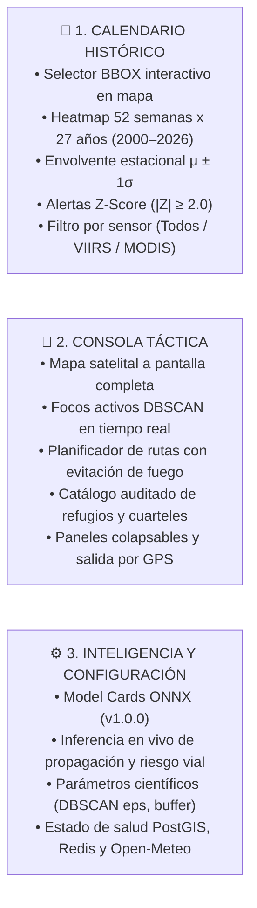

# 🔥 SeMF 2.0 — Plataforma Geoespacial de Monitoreo de Incendios y Evacuación

[](https://github.com/Fjoel00/SeMF-SpaceAppsNASA)
[-2496ED.svg?logo=docker&logoColor=white&style=for-the-badge)](docker-compose.yml)
[](backend/tests/)
[-red.svg?style=for-the-badge)](data/AUDITORIA_DATOS.md)
[](LICENSE)

**SeMF 2.0** es una plataforma científica y geoespacial full-stack de alerta temprana, análisis climatológico de régimen de fuego y cálculo determinista de rutas seguras de evacuación para las provincias de **Córdoba** y **San Luis, Argentina** (BBOX principal `[-66.0, -33.5, -63.5, -31.0]`).

---

## ⚡ Inicio Rápido con Docker (1 Solo Comando)

No requiere registro previo, tokens externos ni claves de API:

```bash
docker compose up --build
```

Abre en tu navegador:
👉 **[http://localhost:8090](http://localhost:8090)**

Verificación de salud del sistema:
```bash
curl http://localhost:8090/api/v1/health
```

---

## 📱 Las 3 Pestañas Principales

La navegación de la plataforma se encuentra unificada y optimizada en 3 módulos esenciales:



### 1. Calendario Histórico (2000–2026)
- **Bounding Box Interactivo:** Selector geográfico directamente sobre el mapa (dibujar arrastrando o restablecer a región núcleo). Al soltar, recalcula dinámicamente las estadísticas climatológicas.
- **Matriz Heatmap Multianual:** Matriz de 52 semanas ISO por 27 años continuos (2000 a 2026). Para 2026 se muestra como año parcial sin proyecciones artificiales.
- **Envolvente Estacional Climatológica:** Media empírica $\mu$ y banda de variabilidad $\mu \pm 1\sigma$ calculadas sobre la serie cerrada de 26 años (2000–2025).
- **Detección de Anomalías Estadísticas:** Alertas visuales destacadas para anomalías extremas ($|Z| \ge 2.0$).
- **Filtro por Sensor:** Alterna entre *Todos*, *Solo VIIRS (375m)* y *Solo MODIS (1km)* recalculando la línea base acorde al instrumento.

### 2. Consola Táctica
- **Mapa Satelital Full-Screen:** Visualización con MapLibre GL sin API key (conmutador rápido *Calle OpenStreetMap* / *Satélite Esri World Imagery* con atribución siempre visible).
- **Paneles Laterales Colapsables:**
  - **Focos y Frentes Activos:** Detecciones agrupadas por clustering geodésico DBSCAN, potencia radiativa (FRP en MW) y velocidad cinemática de propagación.
  - **Rutas de Evacuación Seguras:** Selección de punto de origen (o detección por GPS del dispositivo), destino de refugio y buffer de seguridad configurable (0.5 a 5.0 km). Clasificación en español llano: *Vía Despejada*, *Precaución por Proximidad* o *Ruta Bloqueada*. En caso de cerco total, activa automáticamente el *Corredor Conservador de Flanco*.
  - **Puntos de Evacuación y Refugios:** Catálogo auditado de cuarteles de bomberos, hospitales y centros de evacuación con capacidad y estado.

### 3. Inteligencia y Configuración
- **Model Cards de Machine Learning:** Documentación de los 4 modelos (Hazard, Spread, Road Risk, Route Ranker) serializados en ONNX, entrenados con separación temporal estricta sobre datos reales.
- **Simulador de Inferencia en Vivo:** Evaluación instantánea de velocidad de avance y probabilidad de afectación vial.
- **Parámetros Científicos:** Ajuste de radio DBSCAN (`eps_km`), buffer vial y umbral de antigüedad satelital.

---

## 🛰️ Metodología y Trazabilidad de Datos (NASA FIRMS)

- **Regla Estricta de CERO Datos Sintéticos:** Prohibida la generación, interpolación o simulación de incendios. Todo dato mostrado proviene directamente de descargas oficiales de NASA FIRMS.
- **Cobertura 2000–2026:**
  - MODIS (Terra/Aqua, Collection 6.1): 2000–2012 (y NRT reciente).
  - VIIRS (S-NPP, NOAA-20, NOAA-21, Collection 2): 2012–2026.
- **Armonización Física:** Canales térmicos Ch4 (~4 µm) y Ch5 (~11 µm), gradiente $\Delta T$, Fire Radiative Power (FRP), densidad radiativa $MW/km^2$ según huella de escaneo, y normalización de confianza continua $[0.0, 1.0]$.
- **Deduplicación Inter-Sensor:** Regla determinista documentada: ante observaciones colocalizadas el mismo día (< 1 km), prevalece la mayor resolución espacial de VIIRS (375 m) sobre MODIS (1 km), eliminando el riesgo de doble conteo.
- **Trazabilidad Criptográfica:** Manifiesto con checksums SHA-256 en [`data/manifest.json`](data/manifest.json) y reporte detallado en [`data/AUDITORIA_DATOS.md`](data/AUDITORIA_DATOS.md).

---

## 🗺️ Mapa Base Libre (Zero API Keys)

El sistema utiliza proveedores de teselas raster abiertos y públicos, sin registrar cuentas ni tokens:
- **OpenStreetMap:** `https://tile.openstreetmap.org/{z}/{x}/{y}.png` (Atribución: *© OpenStreetMap contributors*)
- **Esri World Imagery:** `https://server.arcgisonline.com/ArcGIS/rest/services/World_Imagery/MapServer/tile/{z}/{y}/{x}` (Atribución: *Esri, Maxar, Earthstar Geographics*)

---

## 🧪 Pruebas Automatizadas

Ejecutar pruebas del backend (25 tests de integridad, ruteo y modelos):
```bash
python -m unittest discover -s backend/tests -v
```

Ejecutar pruebas del frontend y verificación de tipos:
```bash
cd frontend
npm run test
npm run build
```
