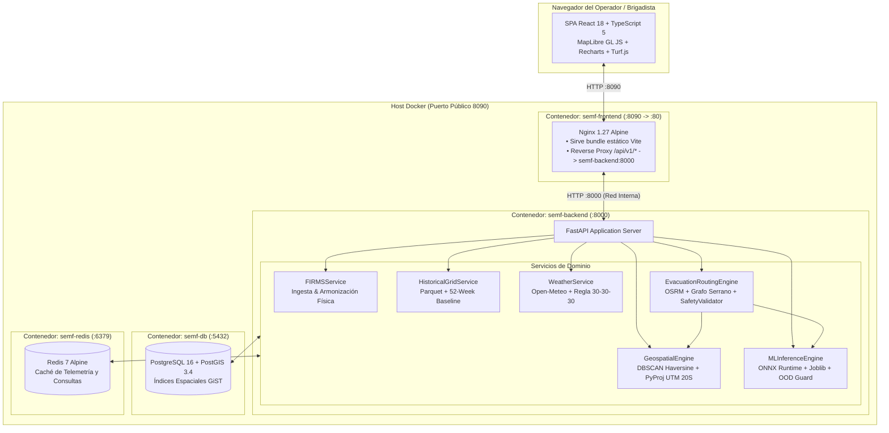

# ARQUITECTURA DEL SISTEMA — SeMF 2.0

## 1. Visión Arquitectónica
SeMF 2.0 implementa una arquitectura limpia de microservicios modulares contenedorizados, diseñada para alta confiabilidad en escenarios de emergencia por incendios forestales. Toda la lógica científica, geoespacial, de ruteo y de inferencia de Machine Learning reside en el backend, mientras que el frontend actúa como una consola de visualización e interacción reactiva consumiendo contratos RESTful documentados bajo OpenAPI 3.1.

---

## 2. Diagrama de Arquitectura de Contenedores y Servicios

---

## 3. Responsabilidades por Capa y Módulo

### 3.1 Capa de API (`backend/app/api/v1/`)
- `GET /api/v1/health`: Estado de salud detallado de base de datos, caché, motor geoespacial, motor de rutas y artefactos ML cargados.
- `GET /api/v1/dashboard/summary`: KPIs globales, desglose por sensor/satélite, serie temporal de pasadas, ranking de frentes activos y estado de refugios.
- `GET /api/v1/fires/active`: Frentes consolidados (polígonos GeoJSON), detecciones puntuales armonizadas (MODIS/VIIRS), isócronas de propagación (1h, 3h, 6h) y métricas de calibración inter-sensor.
- `POST /api/v1/fires/simulate`: Evaluación efímera de escenarios de inyección operativa (focos simulados y condiciones meteorológicas personalizadas) sin contaminar la base de datos de detecciones reales.
- `POST /api/v1/fires/ingest`: Disparo bajo demanda del pipeline de ingesta NASA FIRMS (modo API en vivo o caché/respaldo local).
- `GET /api/v1/historical/calendar`: Consulta de la serie histórica de 26 años (2000–2026) filtrable por año, intervalo de años y Bounding Box (`min_lon,min_lat,max_lon,max_lat`), devolviendo la matriz de 52 semanas, curva $\mu \pm 1\sigma$, Z-Scores y focos anuales.
- `POST /api/v1/routing/evacuate`: Motor de cálculo de rutas de evacuación inteligentes (evalúa múltiples refugios y caminos alternativos, intersecciones con zonas de exclusión, buffers de seguridad, antigüedad de datos y score de riesgo ML por tramo).
- `GET /api/v1/shelters`: Catálogo completo de refugios, estaciones de bomberos, hospitales y centros de defensa civil con auditoría en vivo de distancia al incendio más cercano.
- `GET /api/v1/ml/models` y `POST /api/v1/ml/predict-risk`: Metadatos de modelos entrenados (*Model Cards*), importancia de características, métricas de evaluación y simulador de inferencia directa.
- `GET /api/v1/settings` y `PUT /api/v1/settings`: Lectura y actualización de parámetros científicos (`eps_km`, `min_samples`, `safety_buffer_km`, `staleness_threshold_hours`).

### 3.2 Motor Geoespacial (`backend/app/geospatial/`)
- **Transformaciones Cartográficas Exactas (`PyProj`):** Convierte geometrías de `EPSG:4326` (WGS84 lat/lon) a `EPSG:32720` (WGS 84 / UTM zone 20S, en metros) para calcular áreas exactas en hectáreas (`ha`), perímetros y buffers de seguridad métricos, reproyectando luego a GeoJSON estándar (`CRS84`).
- **Reconstrucción de Frentes (`clustering.py`):** Ejecuta DBSCAN con métrica geodésica Haversine ($\varepsilon = 2.5\text{ km}$ por defecto) y genera envolventes geométricas mediante `Shapely` (`concave_hull` / `convex_hull` + buffer de huella de píxel).
- **Cinemática e Isócronas (`kinematics.py`):** Calcula velocidad y azimut observados entre pasadas satelitales y proyecta polígonos de propagación a 1h, 3h y 6h combinando vectores de viento de Open-Meteo y la tasa de avance estimada por el modelo ML.

---

## 4. Contratos de Intercambio Geoespacial
- Todas las geometrías expuestas al frontend cumplen el estándar **OGC GeoJSON (RFC 7946)** con orden de coordenadas `[longitude, latitude]` en `geometry.coordinates`, mientras que los atributos tabulares explicitan `centroid_lat` y `centroid_lon` para evitar ambigüedades.
