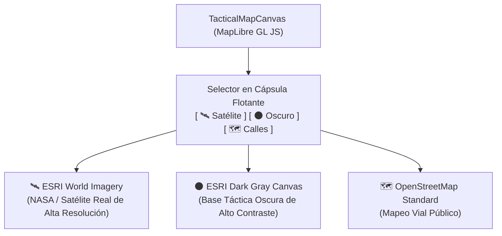

# DISEÑO UX/UI, SISTEMA VISUAL Y WIREFRAMES — SeMF 2.0

## 1. Dirección Visual: Consola SaaS Satelital de Misión Crítica

SeMF 2.0 implementa un lenguaje visual moderno inspirado en consolas de comando aeroespaciales y plataformas SaaS de observabilidad de alta gama, combinando rigor científico con microinteracciones fluidas y componentes visuales ergonómicos.

### 1.1 Paleta Cromática Oficial (Inspirada en ColorSelect)
| Token Semántico | Hex | Función Visual en la Interfaz |
| :--- | :---: | :--- |
| `brand-electric-orange` | **`#FF6117`** | Color primario de marca, focos activos, rutas óptimas recomendadas, botones de acción destacados (`+ Nuevo Escenario`) y medidores radiales |
| `surface-matte-charcoal` | **`#252525`** | Tarjetas de métricas, contenedores elevados, fondos de buscador en cápsula y pistas de medidores de arco |
| `surface-deep-backdrop` | **`#141416`** | Lienzo base principal y paneles de navegación |
| `surface-card-elevated` | **`#1E1E22`** | Tarjetas activas, barras de encabezado y menús laterales con esquinas súper redondeadas (`rounded-3xl`) |
| `text-crisp-white` | **`#EAEAEA`** | Tipografía primaria de alta legibilidad y encabezados |
| `text-muted-gray` | **`#A0A0A8`** | Etiquetas secundarias, unidades de medida y toponimia |
| `border-subtle` | **`#333338`** / `#38383E` | Delimitadores de 1px limpios para tarjetas y modales |
| `status-safe-emerald` | **`#10B981`** | Rutas de evacuación seguras y refugios certificados |
| `status-warning-amber` | **`#F59E0B`** | Conos de avance a 3h y tramos viales con precaución por humo |
| `status-critical-red` | **`#DC2626`** | Perímetros de fuego activos, saturación térmica y vías cortadas |

### 1.2 Tipografía y Jerarquía
- **Fuente Primaria UI:** `Plus Jakarta Sans` — excelente jerarquía, legibilidad y calidez moderna.
- **Fuente Monoespaciada Técnica:** `JetBrains Mono` con `tabular-nums` obligatorio en coordenadas GPS, temperaturas en Kelvin ($K$), potencia radiativa ($\text{MW}$), energía ($\text{MJ}/\text{GJ}$), distancias ($\text{km}$) y tiempos de escape ($\text{min}$).

---

## 2. Componentes de Diseño Clave

### 2.1 Medidores Radiales en Arco (*Radial Arc Gauges*)
- Inspirados en interfaces de control de operaciones avanzadas.
- Semicírculo SVG de 180° con pista de fondo en `#38383E` y arco de progreso en `#FF6117` o esmeralda `#10B981`.
- Callout flotante tipo cápsula en la esquina superior con el porcentaje de llenado exacto (`83%`, `92%`, `66%`).
- Valor numérico central en fuente monoespaciada de gran peso visual (`374.5 MW`, `24 Refugios`).

### 2.2 Controles Segmentados en Cápsula (*Pill Selectors*)
- Píldoras horizontales redondeadas (`rounded-full`) alojadas dentro de un contenedor en bajo relieve `#252525`.
- Píldora activa con fondo `#FF6117`, texto blanco y sombra sutil para selección instantánea de provincias (`Todos`, `Córdoba`, `San Luis`).

### 2.3 Buscador Integrado en Cápsula
- Input de búsqueda con icono de lupa estilizado para filtrado en tiempo real de frentes de fuego, rutas y centros de evacuación.

### 2.4 Botón de Acción Rápida Flotante (*FAB*)
- Botón `+ Nuevo Escenario` en `#FF6117` con bordes redondeados completos y microinteracción de elevación al pulsar.

---

## 3. Arquitectura Cartográfica Libre de API Key (Cero Carto)

Para garantizar funcionamiento continuo, autonomía y cero dependencia de cuotas propietarias, se reemplazó CartoCDN por tres fuentes globales oficiales y gratuitas:

1. **🛰️ ESRI World Imagery (Satélite Real):**
   `https://server.arcgisonline.com/ArcGIS/rest/services/World_Imagery/MapServer/tile/{z}/{y}/{x}`  
   Muestra el relieve topográfico, vegetación y valles serranos de Córdoba y San Luis con resolución fotográfica.
2. **🌑 ESRI Dark Gray Canvas (Táctico Oscuro):**
   `https://server.arcgisonline.com/ArcGIS/rest/services/Canvas/World_Dark_Gray_Base/MapServer/tile/{z}/{y}/{x}`  
   Base minimalista en tonos carbón, optimizada para destacar vectores de fuego e isócronas sin interferencia visual.
3. **🗺️ OpenStreetMap Public:**
   `https://tile.openstreetmap.org/{z}/{x}/{y}.png`  
   Red vial abierta para inspección detallada de caminos secundarios y accesos.

---

## 4. Especificación de Wireframes (8 Módulos)

1. **Dashboard Principal (`/dashboard`):** 4 medidores radiales en arco superiores + selector de provincia en cápsula + mapa satelital ESRI + ranking de frentes en tarjetas elevadas `#252525`.
2. **Monitor Satelital NRT (`/monitor`):** Lienzo cartográfico completo con selector de capas libres + inspector lateral de píxel MODIS/VIIRS con diferencial térmico $\Delta T$ y saturación física $I_4$.
3. **Consola Táctica (`/tactical`):** Vector cinemático de frentes + conos 1h/3h/6h + interruptor de simulación operativa para entrenamiento de brigadas.
4. **Planificador de Rutas (`/routing`):** Selección de origen GPS/mapa + cálculo OSRM multi-alternativa + perfiles de riesgo vial por segmento coloreados en `#FF6117` y esmeralda.
5. **Calendario Histórico 2000–2026 (`/historical`):** Matriz climatológica de 52 semanas ISO con curva empírica $\mu \pm 1\sigma$.
6. **Inteligencia Predictiva ML (`/ml-analytics`):** *Model Cards* de los 4 modelos (Scikit-learn, LightGBM, XGBoost) con barras de importancia de variables en cápsulas redondeadas.
7. **Red de Refugios (`/shelters`):** Directorio auditado con badges de estado y proximidad a la amenaza.
8. **Configuración & Salud (`/settings`):** Monitor de salud de contenedores Docker y sliders de parámetros científicos.
