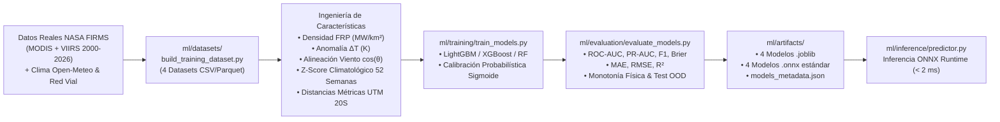

# ROADMAP Y ARQUITECTURA DE MACHINE LEARNING — SeMF 2.0

## 1. Principios Rectores de Machine Learning en Emergencias
1. **Separación Estricta entre Predicción y Restricción Física:** Los modelos de Machine Learning aportan estimaciones de velocidad de propagación, scores de exposición por segmento vial, evolución temporal del peligro y priorización multicriterio de alternativas, pero **jamás** reemplazan los algoritmos de búsqueda en grafos ni anulan una restricción geométrica de seguridad (intersección con perímetro activo o zona de exclusión).
2. **Entrenamiento Real, Benchmark Multi-Algoritmo y Reproducibilidad:** Prohibido exportar modelos vacíos o sin evaluar. Todos los modelos se entrenan mediante scripts reproducibles (`ml/training/train_models.py`) sobre datos derivados del catálogo real de NASA FIRMS para Córdoba y San Luis, comparando algoritmos líderes:
   - **Scikit-learn** (`GradientBoostingRegressor`, `GradientBoostingClassifier`, `RandomForest`)
   - **LightGBM** (`LGBMRegressor`, `LGBMClassifier` con calibración Sigmoide)
   - **XGBoost** (`XGBRegressor`, `XGBClassifier`)
   Se evalúan en partición de validación (`ml/evaluation/evaluate_models.py`) y se serializan en dual format (`.joblib` y `.onnx` estándar con `skl2onnx`) junto con su ficha técnica (`metadata.json`).
3. **Fallback Determinista Garantizado:** Si un modelo no puede cargarse o recibe entradas fuera del rango de entrenamiento (*Out-of-Distribution*), el sistema conmuta de forma transparente al motor determinista físico y notifica el modo de evaluación en la respuesta de la API.

---

## 2. Pipeline de Machine Learning

---

## 3. Especificación de los 4 Modelos de Machine Learning

### 3.1 Modelo 1: `FireSpreadPredictor` (`v1.0.0`)
- **Objetivo:** Estimar la velocidad de propagación frontal del incendio (`spread_speed_kmh`) para dimensionar dinámicamente los conos de avance a 1h, 3h y 6h.
- **Variables de Entrada (Features):**
  1. `frp_peak_mw`: Potencia radiativa pico de la pasada satelital ($\text{MW}$).
  2. `frp_density_mw_km2`: Densidad media de potencia radiativa ($\text{MW/km}^2$).
  3. `delta_temp_k`: Diferencial térmico medio $\Delta T = T_4 - T_5$ ($\text{K}$).
  4. `points_count`: Cantidad de detecciones satelitales activas en el frente.
  5. `wind_speed_kmh`: Velocidad del viento a $10\text{ m}$ ($\text{km/h}$).
  6. `relative_humidity_pct`: Humedad relativa del aire ($\%$).
  7. `temperature_c`: Temperatura ambiente a $2\text{ m}$ ($^\circ\text{C}$).
  8. `seasonal_z_score`: Anomalía estacional de la celda en la semana ISO actual.
- **Algoritmo Seleccionado:** `GradientBoostingRegressor` (MAE: $0.0825\text{ km/h}$, RMSE: $0.1053\text{ km/h}$, $R^2: 0.9794$).
- **Artefactos:** `spread_model_v1.joblib`, `spread_model_v1.onnx`, `spread_model_v1_metadata.json`.

### 3.2 Modelo 2: `RoadSegmentRiskClassifier` (`v1.0.0`)
- **Objetivo:** Estimar la probabilidad calibrada $\hat{p} \in [0, 1]$ de que un segmento vial resulte afectado por fuego o pluma densa durante la ventana de evacuación (próximas 3 horas).
- **Variables de Entrada (Features):**
  1. `dist_to_perimeter_km`: Distancia mínima métrica desde el segmento vial al perímetro activo más cercano ($\text{km}$).
  2. `dist_to_cone_1h_km`: Distancia mínima al cono proyectado de 1 hora ($\text{km}$).
  3. `dist_to_cone_3h_km`: Distancia mínima al cono proyectado de 3 horas ($\text{km}$).
  4. `wind_alignment_cos`: Coseno del ángulo entre el vector de empuje del viento y la posición del tramo ($\cos(\theta) \in [-1, 1]$).
  5. `fire_frp_mw`: Potencia radiativa del frente amenazante ($\text{MW}$).
  6. `wind_speed_kmh`: Velocidad del viento ($\text{km/h}$).
  7. `relative_humidity_pct`: Humedad relativa ($\%$).
  8. `data_age_hours`: Antigüedad de la última detección satelital ($\text{horas}$).
- **Algoritmo Seleccionado:** `LightGBMClassifier + SigmoidCalibration` (ROC-AUC: $0.9946$, PR-AUC: $0.9901$, F1: $0.9373$, Brier Score: $0.0290$, Accuracy: $95.66\%$).
- **Artefactos:** `road_risk_model_v1.joblib`, `road_risk_model_v1.onnx`, `road_risk_model_v1_metadata.json`.

### 3.3 Modelo 3: `WildfireHazardTemporalPredictor` (`v1.0.0`)
- **Objetivo:** Estimar la evolución temporal del peligro regional de incendios forestales ($[0, 100]$: Bajo, Moderado, Alto, Muy Alto, Extremo) en horizontes temporales de **24 horas, 48 horas y 72 horas** para cualquier coordenada de Córdoba o San Luis.
- **Variables de Entrada (Features):**
  1. `latitude`: Latitud geográfica del punto.
  2. `longitude`: Longitud geográfica del punto.
  3. `week_iso`: Semana ISO del año (1–52).
  4. `historical_eq_count`: Frecuencia histórica acumulada de focos equivalentes (2000–2026).
  5. `wind_speed_kmh`: Velocidad del viento a 10m ($\text{km/h}$).
  6. `temp_max_c`: Temperatura máxima ambiente ($^\circ\text{C}$).
  7. `rh_min_pct`: Humedad relativa mínima ($\%$).
  8. `fwi_estimate`: Índice Canadiense de Clima de Incendios (FWI).
  9. `drought_days`: Días acumulados sin precipitaciones significativas.
- **Algoritmo Seleccionado:** `GradientBoostingRegressor` (MAE: $3.0005$, RMSE: $3.8377$, $R^2: 0.9208$).
- **Artefactos:** `hazard_model_v1.joblib`, `hazard_model_v1.onnx`, `hazard_model_v1_metadata.json`.

### 3.4 Modelo 4: `AlternativeRouteRanker` (`v1.0.0`)
- **Objetivo:** Priorizar y rankear alternativas viales de evacuación mediante optimización multicriterio basada en aprendizaje supervisado.
- **Variables de Entrada (Features):**
  1. `distance_km`: Distancia vial total de la alternativa.
  2. `duration_min`: Tiempo estimado de escape en automóvil.
  3. `mean_segment_risk`: Media del riesgo vial predicho a lo largo de la ruta.
  4. `max_segment_risk`: Pico máximo de exposición vial en el tramo más crítico.
  5. `min_dist_to_fire_km`: Proximidad mínima métrica a los perímetros de fuego activos.
  6. `min_dist_to_cone_3h_km`: Proximidad mínima al cono de avance a 3 horas.
  7. `shelter_verified`: Flag binario de verificación oficial del refugio destino ($1.0$ verificado, $0.0$ no verificado).
  8. `shelter_capacity_score`: Puntuación normalizada de capacidad y servicios del refugio ($[0, 1]$).
- **Algoritmo Seleccionado:** `XGBoostRegressor` (MAE: $0.0266$, RMSE: $0.0332$, $R^2: 0.9258$).
- **Artefactos:** `route_ranker_v1.joblib`, `route_ranker_v1.onnx`, `route_ranker_v1_metadata.json`.

---

## 4. Integración con el Motor de Optimización de Rutas
Para cada ruta candidata $R = \{e_1, \dots, e_m\}$:
1. **Filtro Determinista Absoluto:** Si $\text{Length}(R \cap \Omega_{\text{prohibida}}) > 0$, la ruta queda instantáneamente clasificada como `BLOCKED`. Prohibido recomendarla.
2. **Evaluación de Segmentos en Lote (ONNX Runtime):** Para cada segmento de las rutas transitables, se evalúa `RoadSegmentRiskClassifier` en $<2\text{ ms}$. Si $\hat{p}_i \ge 0.65$, el segmento se destaca en color ámbar/rojo como tramo de alta exposición con advertencia kilométrica exacta.
3. **Ponderación Multicriterio (AlternativeRouteRanker):** Las rutas transitables se evalúan con el modelo de ranking, asignando a cada una su score de conveniencia `ml_utility_score` $\in [0, 1]$ y marcando la alternativa óptima recomendada.
4. **Priorización de Refugios Verificados Oficialmente:** Ante alternativas de similar distancia, el sistema siempre prioriza cuarteles de bomberos y centros de evacuación oficiales certificados.
