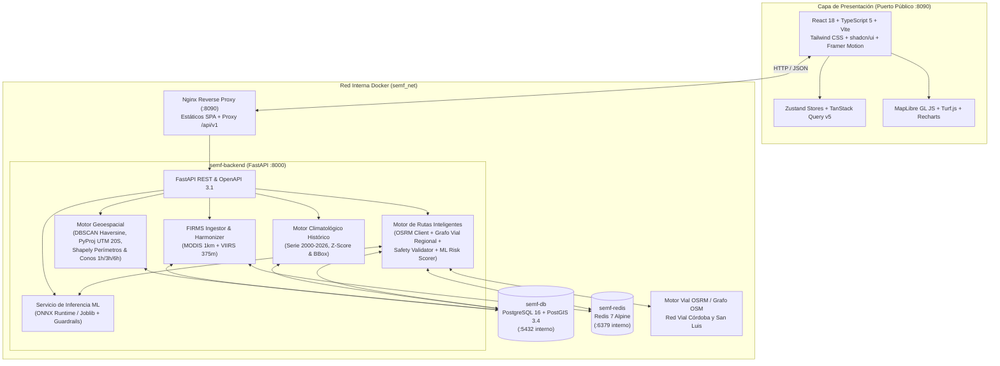
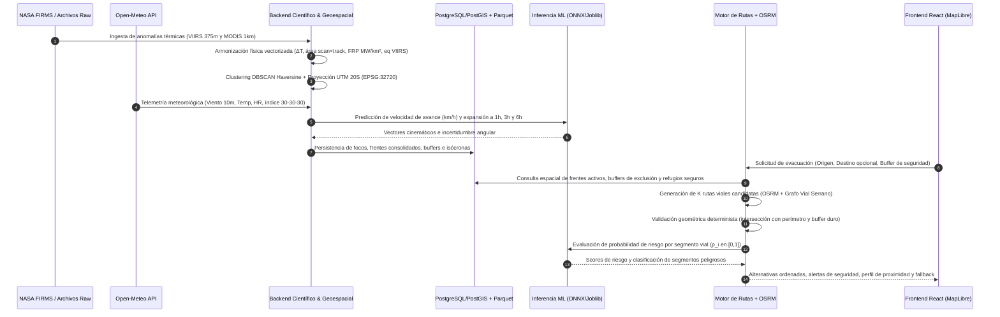

# PLAN MAESTRO DE INGENIERÍA — SeMF 2.0
**Servicio de Monitoreo de Fuego, Armonización Satelital Multi-Sensor y Evacuación Geoespacial Inteligente**

---

## 1. Diagnóstico del Sistema Actual (`HackatonNASA`)

### 1.1 Estado de Protección del Repositorio Original
- **Ubicación original:** `c:/Users/Usuario/Documents/HackatonNASA` (entrega oficial de la hackathon NASA Space Apps Challenge).
- **Regla de integridad:** El repositorio original ha sido auditado exclusivamente en **modo de solo lectura**. No se ha modificado ni se modificará ningún archivo, commit, rama ni configuración dentro de él.
- **Ubicación del nuevo proyecto independiente:** `c:/Users/Usuario/Documents/SeMF-SpaceAppsNASA/SeMF-2.0/`.

### 1.2 Hallazgos Técnicos de la Auditoría
1. **Arquitectura Monolítica Basada en Archivos Estáticos:**
   - El servidor original (`app_server.py`) utiliza `http.server.SimpleHTTPRequestHandler` sobre el puerto `8080` con un único bloqueo global (`threading.Lock`) y ejecuta `pipeline_incendios_nasa.py` mediante `subprocess.run`.
   - El compilador `generar_app_tactica.py` (3,091 líneas) concatena una plantilla HTML/JS monolítica e incrusta los archivos `dashboard_data.json` e `historico_riesgo_grid.json` en variables globales del navegador, generando un archivo `output/index.html` de **13.8 MB**.
2. **Núcleo Científico MODIS/VIIRS (Fortalezas y Limitaciones):**
   - **Funciona correctamente:** La clase `ModisViirsHarmonizer` unifica las temperaturas de brillo en los canales MIR ($\sim 4\,\mu\text{m}$) y TIR ($\sim 11\,\mu\text{m}$), calcula la anomalía térmica $\Delta T = T_4 - T_5$, proyecta el área del píxel ($\text{scan} \times \text{track}$), obtiene la densidad de potencia radiativa ($\text{MW/km}^2$), normaliza las escalas de confianza dispares (MODIS $0\text{–}100\%$ vs VIIRS `l/n/h`) e integra trapezoidalmente la Energía Radiativa del Fuego (`FRE` en $\text{MJ}$).
   - **Requiere refactorización:** El procesamiento utiliza `.apply(..., axis=1)` fila por fila en lugar de vectorización NumPy; el cálculo de áreas y buffers usa una aproximación equirrectangular simple ($111.32\text{ km/grado}$) en lugar de proyección cartográfica métrica (`EPSG:32720` UTM Zona 20S con `PyProj` y `Shapely`); y `BurningActivityCalendar.get_baseline_curve` dentro de `pipeline_incendios_nasa.py` utiliza una onda sinusoidal sintética (`math.sin`) que diverge de la grilla empírica real de `procesar_historico_firms.py`.
3. **Motor de Rutas y Refugios en el Original:**
   - El ruteo se ejecuta en el navegador (`fetchAndDrawOsrmEscapeRoute`) llamando directamente al servidor público de demostración de OSRM con un timeout de `1800 ms`, sin solicitar rutas alternativas (`alternatives=true` ausente).
   - **Restricción crítica detectada:** El código original bloquea el cálculo de rutas si el usuario no se encuentra ya dentro del cono de propagación (`if (!isInsidePropagationCone) return;`), impidiendo la planificación preventiva.
   - **Validación insuficiente:** Solo comprueba `turf.lineIntersect` contra el borde exacto del polígono y el cono de 1h, sin aplicar un buffer de seguridad térmica/humo ni evaluar la incertidumbre de propagación o la antigüedad del dato satelital.
   - **Refugios hardcodeados:** Utiliza un arreglo estático (`SAFE_SHELTER_HUBS`) de 12 coordenadas genéricas sin metadatos de capacidad, tipo de efector, estado operativo ni confiabilidad verificada.
4. **Ausencia de Machine Learning Predictivo y Base de Datos:**
   - No existe ningún modelo supervisado entrenado ni pipeline de inferencia ML (solo clustering `DBSCAN`).
   - No existe base de datos relacional/espacial (PostgreSQL/PostGIS) ni caché en memoria (Redis).

---

## 2. Arquitectura Propuesta para SeMF 2.0

SeMF 2.0 adopta una arquitectura **modular orientada a servicios contenedorizados**, separando estrictamente la capa de presentación (SPA React + MapLibre GL), la capa de orquestación y lógica de dominio (FastAPI + Servicios Científicos/Geoespaciales), el motor de ruteo y validación de seguridad (OSRM + Shapely + PostGIS), el motor de inferencia de Machine Learning (ONNX Runtime / Joblib) y la capa de persistencia (PostgreSQL/PostGIS + Parquet + Redis).

### 2.1 Diagrama General de Componentes

---

## 3. Diagrama de Flujo de Datos

---

## 4. Stack Tecnológico Justificado

| Dominio | Tecnologías Seleccionadas | Justificación de Ingeniería |
| :--- | :--- | :--- |
| **Frontend** | React 18, TypeScript 5, Vite, Tailwind CSS, shadcn/ui, Framer Motion, Zustand, TanStack Query, React Router v6, Recharts, MapLibre GL JS, Turf.js | Arquitectura SPA tipada, modular y mantenible. MapLibre GL JS renderiza capas vectoriales masivas mediante WebGL sin requerir tokens comerciales. |
| **Backend** | Python 3.11, FastAPI, Pydantic v2, SQLAlchemy 2.0, GeoAlchemy2, GeoPandas, Shapely 2.0, PyProj, NumPy, Pandas | Ecosistema científico y geoespacial estándar de la industria con validación de esquemas estricta y generación automática de especificación OpenAPI 3.1. |
| **Persistencia y Datos** | PostgreSQL 16 + PostGIS 3.4, Redis 7, Apache Parquet, GeoJSON (OGC CRS84) | PostGIS provee índices espaciales GiST para intersecciones y distancias; Parquet comprime y acelera las consultas históricas de 26 años; Redis cachea meteorología y cálculos frecuentes. |
| **Machine Learning** | Scikit-learn, LightGBM, XGBoost, ONNX Runtime, Joblib | Modelos de boosting de árboles son el estado del arte en datos tabulares/geoespaciales heterogéneos; ONNX Runtime permite inferencia en milisegundos desacoplada del entorno de entrenamiento. |
| **Infraestructura** | Docker, Docker Compose, Nginx | Despliegue local determinista en un solo comando (`docker compose up --build`) expuesto en `http://localhost:8090`. |

---

## 5. Diseño Preliminar de la Base de Datos

El modelo de datos espacial en PostgreSQL/PostGIS se estructura en 6 tablas principales con índices espaciales `GiST`:
1. `satellite_detections`: Detecciones individuales armonizadas (`geom_point GEOMETRY(Point, 4326)`, `sensor_family`, `temp_ch4_k`, `temp_ch5_k`, `delta_temp_k`, `frp_mw`, `frp_density_mw_km2`, `viirs_equiv_count`, `confidence_score`, `acq_datetime_utc`).
2. `fire_events`: Frentes de incendio consolidados por DBSCAN (`centroid_geom`, `perimeter_geom GEOMETRY(Polygon, 4326)`, `buffer_exclusion_geom`, `frp_peak_mw`, `fre_est_mj`, `detection_area_ha`, `spread_speed_kmh`, `spread_azimuth_deg`, `severity_level`).
3. `propagation_cones`: Isócronas proyectadas a 1h, 3h y 6h (`cone_geom GEOMETRY(Polygon, 4326)`, `horizon_hours`, `wind_speed_kmh`, `wind_dir_deg`, `ml_spread_prob`).
4. `safe_shelters`: Catálogo auditado de cuarteles de bomberos, hospitales, centros de defensa civil y refugios (`geom_point`, `category`, `capacity_persons`, `has_medical_support`, `has_water_supply`, `is_verified_reliable`, `operational_status`).
5. `historical_grid_cells`: Celdas de $0.15^\circ \times 0.15^\circ$ con estadísticas empíricas de las 52 semanas ISO entre 2000 y 2026 (`cell_geom`, `weekly_stats_json`).
6. `evacuation_route_logs`: Auditoría de rutas calculadas, validaciones de seguridad y alertas emitidas.

---

## 6. Diseño del Sistema de Machine Learning

Se separan estrictamente dos tareas predictivas entrenadas sobre datos reales de Córdoba y San Luis:
1. **`FireSpreadPredictor` (`v1.0.0`)**: Modelo regresor (`LightGBM` / `XGBoost` / `GradientBoosting`) que estima la tasa de propagación lineal ($\text{km/h}$) y el alcance esperado a 1h y 3h a partir de potencia radiativa (`frp_peak_mw`, `frp_density_mw_km2`), anomalía térmica ($\Delta T$), meteorología (`wind_speed_kmh`, `relative_humidity_pct`, `temperature_c`) y anomalía histórica estacional (`z_score`).
2. **`RoadSegmentRiskClassifier` (`v1.0.0`)**: Modelo clasificador calibrado que estima la probabilidad $\hat{p}_i \in [0,1]$ de que un segmento vial $e_i$ quede expuesto a impacto térmico o humo denso en las próximas 3 horas, considerando su distancia métrica al perímetro activo, distancia a los conos de 1h y 3h, alineación angular con el vector de viento a sotavento, FRP del frente y antigüedad del dato satelital.

**Guardrail de Seguridad Crítica:** Ningún modelo de Machine Learning sustituye al validador geométrico determinista. Si un segmento vial intersecta un perímetro activo o su buffer de exclusión térmica configurable, la ruta se marca como `BLOCKED` independientemente del score probabilístico.

---

## 7. Estrategia de Integración de Mapas y Motor de Rutas

1. **Visualización Cartográfica (MapLibre GL JS):**
   - Capas independientes y conmutables: Satélite Esri World Imagery, Terreno/Calles OSM Dark, Píxeles VIIRS ($375\text{ m}$), Píxeles MODIS ($1\text{ km}$), Huellas proyectadas ($\text{scan}\times\text{track}$), Perímetros DBSCAN, Buffers de exclusión, Conos de propagación (1h, 3h, 6h), Red de refugios y Segmentos viales coloreados por nivel de riesgo (`SAFE`, `WARNING`, `DANGER`, `BLOCKED`).
2. **Motor de Rutas de Escape (`backend/app/routing/`):**
   - **Paso 1:** Filtra refugios candidatos fuera de los polígonos de exclusión y prioriza aquellos con `is_verified_reliable = True`.
   - **Paso 2:** Consulta rutas viales alternativas mediante OSRM (`alternatives=true, steps=true, geometries=geojson`) y un motor de grafos viales regional embebido (garantizando disponibilidad 100% offline sobre la red vial principal y secundaria de Córdoba y San Luis).
   - **Paso 3:** Discretiza cada ruta en tramos viales y ejecuta validación topológica en `EPSG:32720` (`Shapely`):
     - Intersección con $\mathcal{P}_{\text{fuego}} \cup \text{Buffer}(d_{\text{seg}})$ $\rightarrow$ **Ruta Descartada (`BLOCKED`)**.
     - Intersección con Cono 1h/3h o proximidad $< 2 \cdot d_{\text{seg}}$ $\rightarrow$ **Tramo Peligroso Penalizado (`WARNING`)**.
   - **Paso 4:** Evalúa cada segmento con `RoadSegmentRiskClassifier` (`.onnx`/`.joblib`) y ordena las alternativas seguras según tiempo efectivo penalizado por riesgo.
   - **Paso 5:** Si todas las rutas viales están bloqueadas por fuego, emite una alerta crítica (`NO_SAFE_ROAD_AVAILABLE`) y calcula un **Corredor Táctico Conservador de Escape Lateral** (perpendicular al eje de avance del frente hacia barlovento/flanco despejado).

---

## 8. Diseño de Infraestructura Docker (`http://localhost:8090`)

- **Contenedores:**
  - `semf-frontend`: Build multi-stage (Node 20 Alpine $\rightarrow$ Nginx Alpine) expuesto en el puerto `8090`.
  - `semf-backend`: Python 3.11 Slim con dependencias geoespaciales (`geos`, `proj`, `gdal`), FastAPI/Uvicorn, inicialización automática de base de datos y artefactos ML.
  - `semf-db`: `postgis/postgis:16-3.4-alpine` con volumen persistente `semf_pgdata` y script de inicialización espacial.
  - `semf-redis`: `redis:7-alpine` con healthcheck integrado.
- **Red interna:** `semf_internal_net` (bridge) aislando los puertos de base de datos y caché; el usuario accede únicamente a `http://localhost:8090`.

---

## 9. Plan de Testing, Riesgos y Criterios de Aceptación

### 9.1 Estrategia de Testing
- **Backend (`pytest`):** Pruebas unitarias y de integración para armonización MODIS/VIIRS, clustering DBSCAN, proyecciones métricas, inferencia ML, endpoints REST y los **8 casos obligatorios del motor de rutas**:
  1. Ruta sin incendios (`SAFE`).
  2. Ruta con un foco cercano (`WARNING` + penalización + alternativa).
  3. Ruta con un incendio sobre el camino directo (`BLOCKED` en directa + desvío seguro).
  4. Varias alternativas disponibles (comparación y ranking multicriterio).
  5. Ninguna ruta segura disponible (`NO_SAFE_ROAD_AVAILABLE` + escape conservador de flanco).
  6. Datos de incendios desactualizados (`STALE_FIRE_DATA` + expansión de buffer de incertidumbre).
  7. Coordenadas inválidas o fuera de rango (`HTTP 422`).
  8. Refugio sin información confiable (`UNVERIFIED_SHELTER_WARNING` + priorización de refugio verificado).
- **Frontend (`vitest` + `tsc`):** Verificación de tipado estricto TypeScript y pruebas de componentes/stores.

### 9.2 Criterios de Aceptación
1. El repositorio original `c:/Users/Usuario/Documents/HackatonNASA` permanece **100% intacto**.
2. La interfaz cuenta con las **8 pantallas profesionales en Dark Mode** sin botones simulados ni funcionalidades vacías.
3. Los modelos de Machine Learning están entrenados con datos reales, evaluados con métricas verificables y exportados en `.onnx` y `.joblib` con su `metadata.json`.
4. El motor de rutas supera los **8 escenarios obligatorios** en la suite automatizada de tests.
5. El comando `docker compose up --build` levanta la plataforma completa en `http://localhost:8090`.
