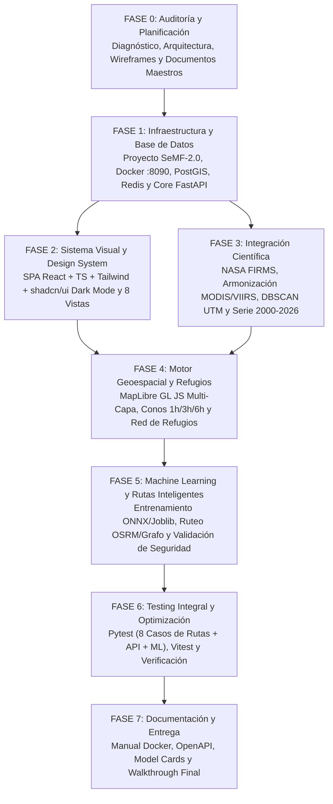

# ROADMAP DE IMPLEMENTACIÓN — SeMF 2.0

## Resumen de Fases de Ingeniería

---

## Detalle de Fases, Entregables y Criterios de Aceptación

### FASE 0 — Auditoría y Planificación
- **Tareas:** Inspección de solo lectura de `HackatonNASA`, inventario de componentes, diseño de arquitectura, wireframes de las 8 pantallas y creación de los 6 documentos técnicos en `docs/`.
- **Dependencias:** Ninguna.
- **Entregables:** `docs/PLAN_MAESTRO_SEMF_2.0.md`, `docs/ARQUITECTURA.md`, `docs/DISEÑO_UX_UI.md`, `docs/ML_ROADMAP.md`, `docs/ROADMAP.md`, `docs/DECISIONES_TECNICAS.md`.
- **Criterio de aceptación:** Repositorio original intacto y plan aprobado.

### FASE 1 — Infraestructura y Persistencia
- **Tareas:** Estructura modular en `SeMF-2.0/`, configuración de `docker-compose.yml` en puerto `8090`, inicialización de PostgreSQL/PostGIS, Redis, configuración Pydantic y modelos SQLAlchemy.
- **Dependencias:** Fase 0.
- **Entregables:** `docker-compose.yml`, `.env.example`, `infrastructure/database/01_init_postgis.sql`, `backend/app/core/`, `backend/app/models/`.
- **Criterio de aceptación:** Servicios configurados con healthchecks y aislamiento de red interna.

### FASE 2 — Sistema Visual (Frontend React + TypeScript)
- **Tareas:** Creación de SPA en React 18 + TypeScript + Vite + Tailwind CSS, diseño Dark Mode satelital, navegación lateral de 8 módulos, stores Zustand y cliente API con TanStack Query.
- **Dependencias:** Fase 1.
- **Entregables:** `frontend/src/layouts/`, `frontend/src/stores/`, `frontend/src/features/*` (8 módulos completos).
- **Criterio de aceptación:** Compilación TypeScript estricta (`tsc --noEmit`) y build de producción limpio (`vite build`).

### FASE 3 — Integración Científica (FIRMS, MODIS/VIIRS, Clima e Históricos)
- **Tareas:** Implementación vectorizada de `ModisViirsHarmonizer`, ingesta NASA FIRMS con caché y fallback calibrado, integración con Open-Meteo (incluyendo detección de condición `30-30-30`) y procesador de serie histórica real 2000–2026 en Parquet/JSON.
- **Dependencias:** Fase 1.
- **Entregables:** `backend/app/services/firms_ingestor.py`, `harmonizer.py`, `weather_service.py`, `historical_service.py`.
- **Criterio de aceptación:** Preservación física verificada de MODIS y VIIRS, cálculo exacto de $\Delta T$, densidad de FRP y Z-Score climatológico empírico.

### FASE 4 — Motor Geoespacial y Catálogo de Refugios
- **Tareas:** Clustering DBSCAN Haversine, cálculo de polígonos y buffers en proyección métrica `EPSG:32720` (`PyProj` + `Shapely`), generación de conos de propagación (1h, 3h, 6h), catálogo georreferenciado de cuarteles de bomberos, hospitales y refugios de Córdoba y San Luis, e integración con MapLibre GL JS.
- **Dependencias:** Fases 2 y 3.
- **Entregables:** `backend/app/geospatial/`, `data/shelters/refugios_bomberos_cba_sl.geojson`, `frontend/src/components/map/`.
- **Criterio de aceptación:** Capas GeoJSON OGC válidas y renderizado interactivo multicapa.

### FASE 5 — Machine Learning y Motor de Rutas de Escape Inteligentes
- **Tareas:** Generación de datasets de entrenamiento, entrenamiento y evaluación de `FireSpreadPredictor` y `RoadSegmentRiskClassifier`, exportación a `.onnx` y `.joblib` con `metadata.json`, cliente OSRM + grafo vial regional de respaldo, validador determinista de seguridad (`safety_validator.py`) y optimizador de rutas (`engine.py`).
- **Dependencias:** Fases 3 y 4.
- **Entregables:** `ml/datasets/`, `ml/training/`, `ml/evaluation/`, `ml/inference/`, `ml/artifacts/`, `backend/app/routing/`.
- **Criterio de aceptación:** Modelos entrenados con métricas reales y motor de rutas diferenciando rutas seguras, expuestas y bloqueadas con soporte de escape conservador.

### FASE 6 — Testing Integral y Calidad
- **Tareas:** Implementación y ejecución de pruebas automatizadas en backend (`pytest`), validación de los **8 casos obligatorios de rutas**, pruebas de modelos ML y pruebas de frontend (`vitest`).
- **Dependencias:** Fase 5.
- **Entregables:** `backend/tests/test_scientific_pipeline.py`, `backend/tests/test_routing_engine.py`, `backend/tests/test_api_endpoints.py`, `frontend/src/tests/`.
- **Criterio de aceptación:** 100% de los tests automatizados pasando sin errores.

### FASE 7 — Documentación y Entrega Final
- **Tareas:** Redacción del `README.md` profesional de `SeMF-2.0`, guía paso a paso de despliegue con Docker en `http://localhost:8090`, documentación de APIs y verificación final de integridad del repositorio original.
- **Dependencias:** Fase 6.
- **Entregables:** `SeMF-2.0/README.md` y artefacto `walkthrough.md`.
- **Criterio de aceptación:** Proyecto completo, documentado, verificado y listo para uso inmediato.
